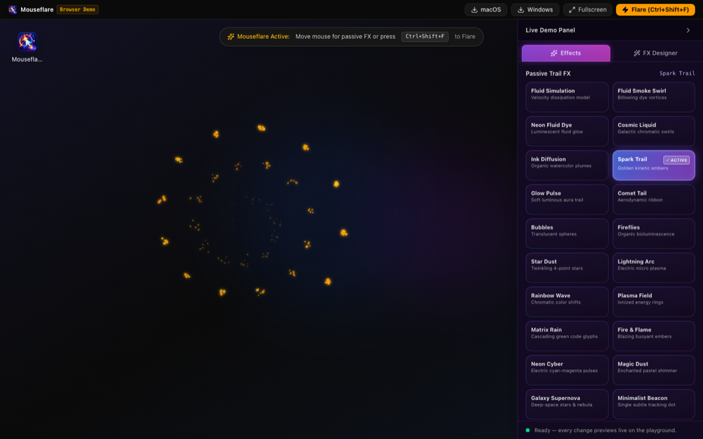
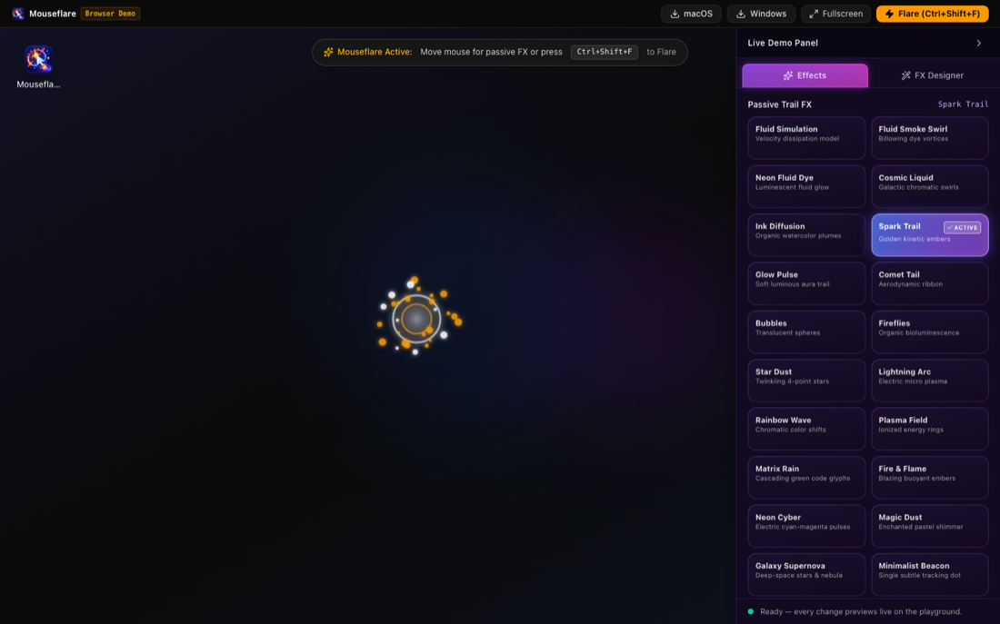

I lose my mouse cursor. Multiple monitors, high-DPI displays, switching between a
dozen windows a minute — the cursor is one pixel-wide thing to track, and half the
time by the moment I need it I'm not even looking at the right screen. Mouseflare
exists because "where's my mouse?" was a question I asked myself several times a
day, and shaking the mouse around until I spot it isn't a real answer.

Mouseflare does two things. While you work, it trails the cursor with a subtle
particle effect — a spark trail, a glow pulse, whatever you pick — so your eye can
follow it without thinking about it. And when you actually need to find it fast, one
global hotkey fires a bright flare at its exact position from any app: press it,
the flare erupts, cursor found. That's the whole feature list, on purpose. I wanted
"impossible to lose" to be true, not "has forty settings you'll never touch."

Everything renders on a transparent, click-through overlay, so it never intercepts a
click or steals focus, and it sits near-idle when you're not actively using it.
Mixed resolutions and mixed DPI scaling across monitors are handled by design —
that combination is exactly what broke every other trick I tried before building
this.

It's free and open source: no account, no telemetry, no network calls, nothing
phoning home. Native apps ship for **macOS and Windows**. If you want to try the
effects before installing anything, there's a
[browser demo](https://offby1-tech.github.io/Mouse-Flare/) with the same FX
Designer the native apps use — tune density, speed, color, trail length, sound, and
reduced-motion, or just grab a preset that looks right.

One honest caveat: the macOS build isn't Apple-notarized yet, so Gatekeeper blocks
the first launch. The [release page](https://github.com/OffBy1-tech/Mouse-Flare/releases)
has the one-line fix. That goes away once notarization clears — for now it's a
speed bump, not a wall.

[Download it](https://github.com/OffBy1-tech/Mouse-Flare/releases) for macOS or
Windows, try the [live demo](https://offby1-tech.github.io/Mouse-Flare/) first, or
go read [the source](https://github.com/OffBy1-tech/Mouse-Flare) — it's all open.
